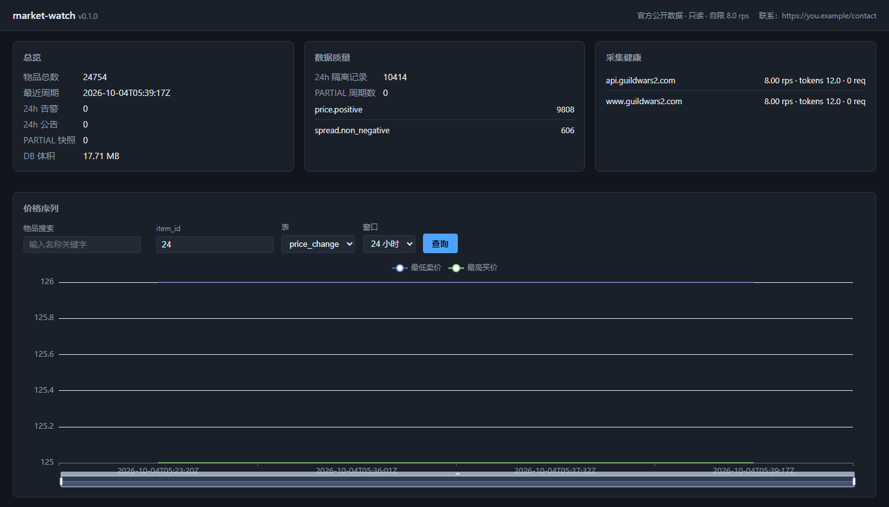
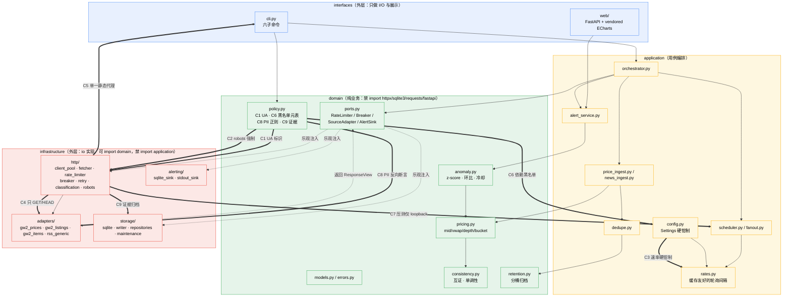

# market-watch

> 本地行情看板 + 异动提醒。**只**读取 Guild Wars 2 官方公开 v2 API 与官方公告 RSS，只读、免鉴权、自限速率；本地 SQLite 落库，FastAPI 看板离线可用。


-brightgreen?style=flat-square)


<!-- 上线前把上面第一个 build 徽标里的 `OWNER` 换成真实 GitHub 组织/用户名；其余徽标是静态 shields.io URL，无需仓库存在即可渲染。 -->

---

## 目录

- [这是什么](#这是什么)
- [演示](#演示)
- [合规声明与免责声明](#合规声明与免责声明)
- [特性](#特性)
- [安装](#安装)
- [五分钟上手](#五分钟上手)
- [CLI 六子命令](#cli-六子命令)
- [看板](#看板)
- [配置怎么改](#配置怎么改)
- [限速与礼貌策略](#限速与礼貌策略)
- [合规检查点 C1–C9](#合规检查点-c1c9)
- [目录结构](#目录结构)
- [开发](#开发)
- [当前进度与已知问题](#当前进度与已知问题)
- [许可证](#许可证)

---

## 这是什么

一个**跑在你自己机器上的信息监控与提醒工具**：轮询 Guild Wars 2 官方公开市场的价格行情与官方公告 RSS，算出 best bid / best ask / spread / VWAP 与盘口水深，用 z-score 与环比阈值判定价格异动，把结果本地落进 SQLite，再在浏览器里给你一张自己的看板 + 一份本地告警记录。

三句话讲清边界：

1. **数据源只有两个**：`api.guildwars2.com/v2/*`（官方 REST，免鉴权）与 `www.guildwars2.com/en/feed/`（官方公告 RSS）。没有第三方镜像、没有聚合黑盒、没有爬虫、没有登录墙。
2. **只出不进**：出网方法白名单只有 `GET` / `HEAD` 且不带 body（`C4`），对官方服务端没有任何写入。
3. **速率是算出来的，不是调出来的**：官方实测 `X-Rate-Limit-Limit: 600`（每 IP 每分钟），乘安全系数 `0.8` → **硬上限 8.0 rps**，由 `pydantic-settings` 的 validator 钳制，环境变量只能调低不能调高（`C3`）。

Windows 用户可以直接下 exe（[安装](#windows-下载发布包不用装-python)），源码用户 `pip install .` 或 `uv sync` 即可。

---

## 演示

<details>
<summary>📈 演示（5 帧 / 7.8 秒 GIF：搜索物品 → 切换图表 → 合规页脚）</summary>



**录于 v0.1.0** —— 5 帧 / 1406×803 / 76 KB / 总时长 7800 ms / 无限循环（`loop=0`），帧时长 1400 → 1400 → 1000 → 1800 → 2200 ms。

1. **首屏**：概览卡（物品总数 **24754** / 最近周期 `2026-10-04T05:39:17Z` / 24h 告警 0 / 24h 公告 0 / PARTIAL 0 / DB **17.71 MB**）、数据质量卡（24h 隔离记录 **10414**：`price.positive` 9808、`spread.non_negative` 606）、采集健康卡（`api.guildwars2.com` 与 `www.guildwars2.com` 各 **8.00 rps**、tokens 12.0、**0 次限流**）。图表默认 `item_id=24`。
2. **搜索**：在「物品搜索」输入框打 `Mighty` → 下拉出现一条结果 `#68 Mighty Country Coat`。
3. **选中**：点该结果 → `item_id` 输入框自动填 `68`，下拉收起（此时图表还没刷新）。
4. **查询**：点「查询」→ 图表从 item 24 切到 item 68。这一帧最能说明问题：Y 轴从 125–126（该物品最低卖价 / 最高买价两条线几乎重合）**整体重算成 0–50**，最低卖价 ≈48、最高买价 ≈7，两条线明显分离。
5. **滚到底部**：「最新告警」「官方公告」两个区块 + 页脚合规声明原文——「数据源：Guild Wars 2 官方 v2 API（免鉴权、官方公开端点）。本看板不采集任何个人信息，不使用代理池，不绕过任何访问控制。」

</details>

> **演示里的数据是真跑真采的，不是 mock**：页面来自本机 `market-watch serve`（`http://127.0.0.1:8765`，Edge headless + CDP 截帧拼接），库里的数据来自 **4 轮 `market-watch once --source gw2_prices`** —— 每轮 `pages=140 / records=27997 / written=24754 / rejects=3445 / quality=COMPLETE`（写入去重后就是概览卡上的 24754 个物品）。
>
> ⚠️ **数据边界，别看错图**：这次演示只覆盖约 **15 分钟的采集跨度（4 个时间点）**，所以曲线是**短序列**，**不代表长期历史行情**；`price_hourly` 表在本次演示里是 **0 行**（rollup 要等 `gc` 滚动窗口才会填充），GIF 画的是默认的 `price_change` 表。想要长序列就让它多跑几轮、再跑一次 `gc`。

---

## 合规声明与免责声明

### 三条铁律（项目设计的前提，不是可选建议）

| # | 铁律 | 落地方式 |
|---|---|---|
| 1 | **绝不触碰游戏客户端** | 无内存读写/修改、无注入、无键鼠模拟、无破解、无脱机挂。依赖黑名单（`pyautogui`/`pydirectinput`/`cv2`/`pymem`/`frida`/`proxy_pool`…）在运行时 `sys.modules` 与 CI 双查（`C6`） |
| 2 | **仅对接官方公开 API** | 数据源只有 GW2 官方 v2 API 与官方公告 RSS，且严格遵守官方公布的速率限制。实测 `api.guildwars2.com/robots.txt` 与 `www.guildwars2.com/robots.txt` 均返回 **404 → 无指令 → 按 RFC 9309 视为允许**；`/v2/commerce/prices/{id}` 与 `/v2/commerce/listings/{id}` **免鉴权**；`Cache-Control: public, max-age=120` |
| 3 | **定位为信息监控与提醒工具** | 纯个人辅助，推送只到本地（看板 / stdout / SQLite sink），不涉及任何盈利、不涉及代练、不涉及任何第三方服务端施压 |

> [!IMPORTANT]
> 本项目**不包含**游戏客户端自动化、不含内存修改、不含键鼠/点击模拟、不绕过鉴权；它只是一个读写自己机器上 SQLite 的本地监控工具。

### 免责声明

- 本项目**仅**适用于个人对**官方公开接口**的读取。任何把本项目采集到的数据用于**商业转售、分发、转授第三方**的行为都不在授权范围内（`LICENSE` 的 MIT 只覆盖代码本身，不覆盖数据的再分发权）。
- 本项目**不得**用于绕过任何鉴权、付费墙、验证码或访问控制；遇到 401/403 的处理是**停机等待人工**，而不是换 UA、换 IP 或换代理。
- 使用者需**自行遵守目标服务方的使用条款**。官方接口可能随时变更限额、加鉴权或封禁出口 IP；本项目不对因此产生的封禁、限流、数据缺失负责。
- 本项目**不包含**、也**不得**被用于任何游戏客户端自动化（键鼠模拟、内存修改、协议逆向、脱机挂）。任何违反这点的二次使用与本项目无关。
- 本项目按 **"AS IS"** 提供，无任何担保；决策请以你看板上的数据为准，工具本身不构成任何投资建议。

> [!WARNING]
> 本工具采集到的数据**不得**用于商业转售或转授第三方；本项目为非营利个人工具，非代练、非代打、无任何盈利用途。

---

## 特性

| # | 特性 | 落地位置 |
|---|---|---|
| 1 | **自建 HTTP 内核**：`httpx` + `asyncio`，每主机令牌桶（AIMD 自适应）+ 每主机并发闸 + 全局在飞闸三层收紧 | `infrastructure/http/client_pool.py`、`rate_limiter.py`、`fetcher.py` |
| 2 | **断线重连与连接池重建**：按 `Retry-After` / `Connection: close` 失效并重建连接池，重建后回调限流器降权再渐进恢复 | `infrastructure/http/client_pool.py`、`interfaces/wiring.py` |
| 3 | **指数退避 + 全抖动重试**：`base=1.0 / factor=2.0 / max=30s`，每次抖动取 `[0, backoff]` 均匀随机，累计时间预算封顶；错误分类只有一个出口 `classification.py` | `infrastructure/http/retry.py`、`classification.py` |
| 4 | **熔断与半开探针**：每主机 closed / open / half-open 状态机，open 到期只放单个探针，探针成功才整体恢复 | `infrastructure/http/breaker.py` |
| 5 | **分页漂移处理**：`X-Result-Total` 实测 27997 且全程在变，用 `dict[item_id]` 累积幂等、漂移率 >10% 标记 `PARTIAL` 并**跳过缺失物品的异动检测**（避免把"这轮没抓到"误判成暴跌） | `infrastructure/adapters/gw2_prices.py` |
| 6 | **数据一致性门**：`prices` 与 `listings` 两端点互证 + `spread >= 0` / `unit_price > 0` / 档位单调性校验；违规记录进 `data_reject` 表并**隔离快照**（异动检测不得消费） | `domain/consistency.py`、`domain/pricing.py` |
| 7 | **PII 反向断言**：parse 侧若命中邮箱 / @handle / 11 位手机样式数字 / 经纬度对，直接丢弃该字段并告警（`C8`） | `domain/policy.py`、`domain/consistency.py` |
| 8 | **落库 · 看板 · 合规自检**：SQLite + WAL + 单写线程批量 upsert 与分层归档；FastAPI + Jinja2 单页 + vendored ECharts 离线看板（降采样 ≤2000 点）；`policy-check` 一次跑完 C1–C9，任一不过退出码 2 | `infrastructure/storage/`、`interfaces/web/`、`domain/policy.py` |

---

## 安装

要求 **Python ≥ 3.13**（`requires-python = ">=3.13"`）。

### 源码：uv（推荐）

```bash
git clone https://github.com/akbar747/market-watch.git
cd market-watch
uv sync --extra dev          # 含 dev 工具链（ruff/black/mypy/pytest）
uv sync                      # 只要运行时
```

### 源码：pip

```bash
git clone https://github.com/akbar747/market-watch.git
cd market-watch
python -m venv .venv && . .venv/Scripts/activate      # Windows
python -m pip install -U pip
pip install .                                          # 只装运行时
pip install -e ".[dev]"                                 # 开发模式
```

### Windows：下载发布包（不用装 Python）

1. 从 Releases 下载 `market-watch.zip`；
2. 解压到任意目录（例如 `D:\tools\market-watch\`）；
3. 双击 / 命令行运行 `market-watch.exe`：

```bat
market-watch.exe --help
set MW_CONTACT_URL=https://your.domain/contact
market-watch.exe policy-check
market-watch.exe serve
```

> 发布包是 **onedir 布局**：`market-watch.exe` + `_internal\` + 同目录 `config\`、`docs\`、`bench\`、`data\`。
> - `data\market_watch.db` —— 数据库（首次运行自动建表），`data\rejects\`、`data\pending\` 为落库缓冲；
> - `config\` —— 数据源与告警规则；
> - `docs\_robots_snapshot.json` 与 `bench\bench_fetch.py` —— **故意随包发布**：`policy-check` 的第 4 项（C2 robots 证据）和第 9 项（C7 压测目标）都要读它们放在「应用根目录」下，少了就 8/9；
> - `MW_*` 路径变量由 `release/market_watch_console.py` 在导入 `market_watch` 之前自动指向 exe 所在目录（不可写时回落到临时目录），搬走整个目录直接复制即可，是便携式的。

### 配置第一步（必须在首次跑之前做）

`.env` 里的 `MW_CONTACT_URL` 会被拼进 UA（形如 `market-watch/0.1.0 (+<contact>)`）。填 `example.invalid` 这类占位符会**拒绝启动**；文档样例 `https://you.example/contact` 会启动但打一条 WARNING，部署前请换成真实可联系地址（隐私考虑可填 personal blog / 邮箱域名，不要填真实邮箱除非你接受它出现在 UA 里）。

```bash
cp .env.example .env          # 然后改 MW_CONTACT_URL
```

#### 为什么仓库里保留 `you.example/contact` 这个占位域

- **`.example` 是 RFC 2606 保留的示例顶级域**（与 `example.com` 同源），不会被真实解析——它出现在这里不是笔误，也不会指向任何真实站点。
- **保留它是为了让合规链路「克隆下来就能跑通」**：`policy-check` 的 C1 要读 UA 里的联系地址，一个能解析的真实地址**不是**跑通的前提，但一个「一眼可见是占位」的地址**是**——它让 UA 自检有明确对象可判。所以默认值就钉在这里。
- **部署 / 自用之前请换成你自己的**：在 `.env` 里设 `MW_CONTACT_URL=https://your.domain/contact`（隐私考虑可用 personal blog / 邮箱域名；除非你接受它出现在 UA 里，否则别填真实邮箱）。
- **`cli.py` 那条 WARNING 是刻意保留的**：`policy-check` 输出里 `⚠️ 文档样例占位域，部署前必须替换` 就是给使用者看的正确提醒，**不是待清理的技术债，不要把它删掉或改成沉默**。同理 `example.invalid` 那一类是**拒绝启动**（比 WARNING 更硬），两者行为不同，别当同一件事。

> 想看全部可配置项就翻 `.env.example`——它是从 `application/config.py` 的 `Settings` 字段逐条导出的，每一项都写了默认值与理由。**`OFFICIAL_LIMIT` 与 `HOST_SAFETY_FACTOR` 故意不在里面**：它们是 `domain/policy.py` 里的代码常量。

---

## 五分钟上手

```bash
# 1) 合规自检，应输出 9/9
market-watch policy-check

# 2) 跑一轮真实行情（唯一会出网的命令）
market-watch once --source gw2_prices

# 3) 起看板
market-watch serve
#   → http://127.0.0.1:8000
```

> 第 2、3 步依赖 `src/market_watch/interfaces/cli.py` 的函数体延迟导入写对（一层 `.`），这处已修并留了防回退注释，见 [当前进度与已知问题](#当前进度与已知问题)。历史上这两条曾因为少写一个点直接崩，而 `policy-check`、`--help`、`status` 全绿——所以改完 cli.py 别只跑前三个，起一次 `serve` 才是硬证据。

`policy-check` 的真实输出（Python 3.13.14 / Windows-11 实测）：

```
[OK]  python=3.13.14 platform=Windows-11-10.0.26100-SP0
[OK]  依赖黑名单: 0 hits
[OK]  UA: market-watch/0.1.0 (+https://you.example/contact) (⚠️ 文档样例占位域，部署前必须替换)
[OK]  robots: api.guildwars2.com -> 404 (无指令 -> allow)   www.guildwars2.com -> 404 (无指令 -> allow)
[OK]  有效速率: 8.00 rps (= 官方 600/min × 安全系数 0.80)   声明=8.00  钳制=否
[OK]  出网方法白名单: GET, HEAD
[OK]  代理: 未配置（trust_env=False，环境变量代理被忽略）
[OK]  数据源注册表: gw2_prices -> 'official_public'/gw2_listings -> 'official_public'/gw2_items -> 'official_public'/gw2_news_rss -> 'official_public'
[OK]  压测目标: 仅 loopback（assert_loopback=有，--force 逃生开关=无）
合规检查通过 9/9
```

`once` 的输出是**单行**（加 `--json` 变 JSON）：

```
cycle=20261003T132900Z source=gw2_prices pages=140 records=27997 written=27997 skipped_unchanged=0 rejects=0 alerts=3 quality=OK drift=0.31% duration=18240ms
```

> 上面这条是**格式示意**：`27997` 是官方 `X-Result-Total` 实测值、`140` 是 `page_size=200` 下的实测页数，
> 其余数字（written / alerts / drift / duration）随官方数据与本机网络而变，**请以你本机跑出来的为准**，
> 不要照抄。看板里的曲线同理，只能用真实跑出来的一轮数据。

定时任务（Windows 任务计划程序 / cron）里建议用 `once`：跑完就退，不留常驻进程。常驻用 `serve`。

### 想先看行为再装环境？跑离线示例

```bash
# C1/C3/C4/C5/C6/C8 合规纯逻辑自检（零出网）
python examples/smoke_policy_check.py          # → 9/9 通过

# 拉单个商品的价格盘口（--off 回放 fixtures，零出网）
python examples/fetch_one_item.py --off        # → best bid / ask / spread / mid / depth
python examples/fetch_one_item.py              # → 同样打到官方端点（唯一出网模式）

# 本地告警推 Webhook（默认只打印 payload，占位域不做真实请求）
python examples/alert_webhook.py               # → 输出 payload，sent=false
python examples/alert_webhook.py --send        # → 才会真的 POST 到 --webhook
```

> [!NOTE]
> `examples/fetch_one_item.py`（不带 `--off`）与 `market-watch once` 是**唯一会产生出网流量**的入口；示例默认关闭真实请求时都会显式打印 `sent : 否`。

---

## CLI 六子命令

```bash
market-watch --help
market-watch --version
market-watch --json              # 全局：所有命令的输出改成 JSON，便于脚本消费
```

| 子命令 | 作用 | 主要参数 |
|---|---|---|
| `once` | 跑一轮就退（定时任务友好）。**唯一会出网的命令** | `--source`（默认 `gw2_prices`）、`--max-pages`（默认 200 硬护栏）、`--cycles`（默认 1）、`--dry-run`（只解析不落库） |
| `serve` | 常驻：周期调度 + 内嵌看板 | `--host`（默认 127.0.0.1）、`--port`（默认 8000）、`--no-web`（只采集不起看板）、`--pid-file`（写 pid 便于 py-spy） |
| `status` | 打印库与源状态摘要（DDL 表行数、数据质量、各源 last_run / 错误分类） | — |
| `gc` | 保留清理 + rollup + `PRAGMA optimize` | `--now`（指定 ISO8601 时间，便于测试保留窗口） |
| `policy-check` | 9 项合规检查点自检，任一不过退出码 2 | — |
| `reset` | 清空运行期数据（危险，二次确认） | `--yes`（跳过确认）、`--keep-schema`（默认保留表结构） |

> `serve` 绑非 loopback 地址会打 WARNING：看板**无鉴权**，同局域网任何人都能看/改。只绑 `127.0.0.1` / `localhost` / `::1`。

---

## 看板

```bash
market-watch serve        # http://127.0.0.1:8000
```

| 路由 | 说明 |
|---|---|
| `/` | 单页看板（Jinja2 + vendored ECharts，离线可用） |
| `/api/summary` | 全市场摘要：条目数、最新价、异动数 |
| `/api/search?q=` | 按物品名搜索 |
| `/api/series?item_id=` | 单品时间序列（服务端降采样 ≤2000 点） |
| `/api/alerts` | 告警列表；`POST /api/alerts/{id}/ack` 认领 |
| `/api/announcements` | 官方公告 |
| `/api/quality` | 数据质量：rejects、漂移率、隔离快照数 |
| `/api/health` | 采集健康度：令牌桶、熔断、重试计数 |
| `/static/*` | `app.css` / `app.js` / `vendor/echarts.min.js` |

---

## 配置怎么改

三处，各管一段：

### 1. `.env`（运行期旋钮）

全部字段与默认值见 [`.env.example`](.env.example)。几个容易踩的：

| 变量 | 默认 | 说明 |
|---|---|---|
| `MW_CONTACT_URL` | `https://you.example/contact` | C1，进 UA。**必填**；默认值是 RFC 2606 保留域，能启动但会打 WARNING，部署前换成真实可联系地址（见上一节） |
| `MW_PER_HOST_RPS` | `8.0` | 只能调低；>8.0 会被静默钳制并打 `rate.clamped` |
| `MW_PER_HOST_CONCURRENCY` | `4` | 单主机在飞请求上限（1–8） |
| `MW_PAGE_SIZE` | `200` | 官方上限，用满它是**唯一合法的提速路径** |
| `MW_DB_PATH` | `src/market_watch/data/market_watch.db` | 相对当前工作目录，脚本请在仓库根跑 |
| `MW_WEB_HOST` / `MW_WEB_PORT` | `127.0.0.1` / `8000` | 看板地址 |

### 2. `config/sources.yaml`（数据源清单）

每个 `source_id` → 适配器 / 端点 / 礼貌参数 / 启用开关。`enabled: false` 的（如 `gw2_listings`）只在观测清单非空时才有意义。文件底部的 `rejected_sources` 是**否决源登记表**：`esi.evetech` 因为 `robots.txt` 直接 `Disallow: /` 被否决，想启用必须书面授权 + 代码变更 + PR 评审，**不允许环境变量开关**。

```yaml
  - id: gw2_prices
    adapter: market_watch.infrastructure.adapters.gw2_prices.Gw2PricesAdapter
    authorization: official_public      # 只允许这一档；policy-check 会校验
    kind: price
    host: api.guildwars2.com
    path: /v2/commerce/prices
    enabled: true
    strategy: paged
    page_size: 200
    interval_seconds: 300
    politeness:
      rps: 8.0
      burst: 12
      concurrency: 4
      min_interval_seconds: 120         # 会被 Cache-Control: max-age=120 抬升
      respect_max_age: true
```

### 3. `config/alerts.yaml`（异动规则）

```yaml
rules:
  - id: price_drop_15pct
    metric: sell_unit_price      # sell_unit_price | buy_unit_price | spread
    kind: pct                    # pct（环比百分比）| zscore（需 window）| abs（绝对值）
    threshold: -15.0             # <0 表示下跌达该幅度，>0 表示上涨达该幅度
    cooldown_seconds: 3600       # 同一 (source, rule, item) 在该窗口内只告警一次
    severity: warn               # info | warn | critical
    enabled: true
```

`sell_price_zscore_4` 那类 `zscore` 规则默认注释掉——它要 60 个历史样本才稳定，冷启动阶段别开。

---

## 限速与礼貌策略

| 项 | 值 | 从哪来 |
|---|---|---|
| 官方速率上限 | **600 req/min**（`X-Rate-Limit-Limit` 实测） | 官方响应头 |
| 安全系数 | **0.8** | `domain/policy.py::HOST_SAFETY_FACTOR`（代码常量） |
| 自限上限 | **8.0 rps**（= 600÷60×0.8） | `EFFECTIVE_RPS_CAP`，validator 硬钳制 |
| 单主机并发 | **4** | `per_host_concurrency` / `sources.yaml` |
| 全局在飞 | **16** | `GLOBAL_INFLIGHT` |
| 令牌突发容量 | **12** | `per_host_burst`（≈1.5 s 的量） |
| 页大小 | **200** | 官方 `X-Page-Size` 上限 |
| min 间隔（跟随缓存） | **120 s**（`Cache-Control: max-age`，listings 实测 1200 s） | `rates.py`，配置配小了只会被抬上去并打 `interval.clamped` |
| 连接池 | max_connections 20 / keepalive 20 / expiry 20 s | httpx `Limits` |
| AIMD | 429/420 → `rate *= 0.5`（下限 1.0 rps）；连续 300 s 干净 → `+10%` 恢复 | `rate_limiter.py` |
| 重试 | 最多 4 次（`base=1.0`, `factor=2.0`, `max=30 s`，全抖动，累计预算 90 s） | `retry.py` |
| 出网方法 | 仅 `GET` / `HEAD`，无 body | `fetcher.py`（C4） |
| 代理 | 单个静态值，含逗号直接拒绝启动 | `client_pool.py`（C5） |

**想提速就少发请求**（用满 `page_size=200`、关掉不需要的源、只观测清单内的物品），**不要提 rps**——那是对抗限额。

> [!WARNING]
> `per_host_rps` 配高了不会被采纳、只会静默/告警降级到 cap；`OFFICIAL_RATE_LIMIT_PER_MIN`、`HOST_SAFETY_FACTOR`、`EFFECTIVE_RPS_CAP` 是代码常量，`.env` 与 `config/*.yaml` **没有任何字段能覆盖它们**。

---

## 合规检查点 C1–C9

`market-watch policy-check` 一次跑完，CI 里是硬 gate；任一不过退出码 2。

| # | 检查点 | 实现 | 可配置绕过 |
|---|---|---|---|
| C1 | UA 自我标识 `market-watch/<ver> (+<contact>)`，占位域拒绝启动 | `domain/policy.py::validate_user_agent` | **不可** |
| C2 | robots.txt 强制（404/无指令按 RFC 9309 视为允许），无开关 | `infrastructure/http/robots.py` | **不可**（豁免需书面授权 + PR 评审） |
| C3 | 速率硬钳制 8.0 rps | `application/config.py` validator | **不可**（env 只能调低） |
| C4 | 只出 `GET`/`HEAD`、无 body | `infrastructure/http/fetcher.py` | **不可** |
| C5 | 单一静态代理、`trust_env=False`、禁代理池 | `infrastructure/http/client_pool.py` | **不可** |
| C6 | 依赖黑名单运行时 + CI 双查 | `domain/policy.py::assert_no_forbidden_deps` | **不可** |
| C7 | 压测只打 loopback，无 `--force` | `bench/bench_fetch.py::assert_loopback` | **不可** |
| C8 | 不采集个人信息（PII 正则反向断言） | `domain/policy.py::assert_no_pii` | **不可** |
| C9 | robots/UA/授权证据归档 | `docs/_robots_snapshot.json` + 架构 §11 | 不可 |

---

## 目录结构

src-layout，`pyproject.toml` 是唯一元数据源（无 `setup.py`、无 `requirements.txt`）。完整版见 [`docs/01-architecture.md`](docs/01-architecture.md) §2。

```text
market-watch/
├── pyproject.toml                 # 依赖 / 构建 / 工具链（唯一真相源）
├── LICENSE                        # MIT
├── .env.example                   # 全部可配置项，必须提交
├── config/
│   ├── sources.yaml               # 数据源清单 + 礼貌参数 + 否决源登记表
│   └── alerts.yaml                # 异动规则（阈值/窗口/冷却/严重级）
├── src/market_watch/
│   ├── domain/                    # 纯业务层：禁 import httpx/sqlite3/fastapi
│   │   ├── models.py  ports.py  errors.py  policy.py
│   │   ├── pricing.py  consistency.py  anomaly.py  retention.py
│   ├── application/               # 用例编排
│   │   ├── config.py  rates.py  scheduler.py  orchestrator.py  fanout.py
│   │   ├── price_ingest.py  news_ingest.py  dedupe.py  alert_service.py
│   ├── infrastructure/
│   │   ├── http/                  # client_pool / fetcher / rate_limiter / breaker / retry
│   │   │                          # classification / robots / lifecycle / metrics
│   │   ├── adapters/              # gw2_prices / gw2_listings / gw2_items / rss_generic + fixtures
│   │   ├── storage/               # sqlite(migrations) / writer / repositories / maintenance
│   │   └── alerting/              # sqlite_sink / stdout_sink
│   └── interfaces/
│       ├── cli.py                 # 六子命令
│       └── web/                   # app / routes / deps / static(vendor) / templates
├── tests/                         # unit / adapters / integration（三层，不依赖网络）
├── bench/                         # bench_fetch.py（仅 loopback）
├── release/                       # PyInstaller 打包：spec / 入口 / build_exe.py
├── docs/                          # 01-architecture.md / 04-secrets-scan.md / DEMO_RECORDING.md
└── data/                          # 运行期数据（gitignore，仅 .gitkeep）
```



依赖方向：`interfaces → application → domain ← infrastructure`，orchestrator 通过 `domain/ports` 反向注入 infrastructure 实现。

---

## 开发

```bash
uv sync --extra dev

uv run ruff check .               # 静态检查（E/F/W/I/UP/B/SIM/DTZ/ANN）
uv run ruff format .              # 格式化（line-length 100）
uv run black --check .            # 与 ruff format 同款风格，CI 双查
uv run mypy                       # 配置文件 src/market_watch
uv run pytest                     # 201 passed @ 本次实测
uv run pytest --cov=market_watch --cov-report=term-missing
uv run market-watch policy-check  # 9 项合规检查点
uv run python bench/bench_fetch.py --pages 8 --rps 8    # 只打本地 loopback
```

打 Windows 发布包（本地/offline）：

```bash
pip install pyinstaller
python release/build_exe.py       # 产物 release/dist/market-watch/ + .zip，末尾自动跑 --help 与 policy-check 冒烟
```

提交前建议装 pre-commit 钩子（ruff/black/trailing-whitespace/end-of-file-fixer）。

---

## 当前进度与已知问题

- ✅ Phase 1 架构 + Phase 2 采集与落库实现完成，测试 **269 passed / 0 failed**（2026-10-04 实测）。
- 覆盖率 **50%**（出处：`pytest --cov=market_watch` 的 TOTAL 行 `TOTAL 4012 1899 932 59`，2026-10-04 实测）。CI 闸门是 `--cov-fail-under=35`——**闸门就是 35，没有别的数**。缺口集中在 `storage/*`、`orchestrator`、`fetcher`、`lifecycle`、`interfaces/web/*`、`cli.py` 这几层，**这几块的用例欢迎来补，直接提 PR**：补完若想上调闸门，只改 `.github/workflows/ci.yml` 里那一处 `--cov-fail-under`（本项目不设更多档位）。
  - 约定只有一条：**不要为了让 CI 变绿而删测试、加 `--deselect`、或加 `-p no:cacheprovider`**。覆盖率是随补随涨的，不是靠调闸门涨的。
- ⚠️ **`cli.py` 的相对导入曾有三处写错（已修复，留档以防回退）**：`src/market_watch/interfaces/cli.py` 里函数体的延迟导入曾写成 `from ...domain`（三层，包深度只有 2，越界）、`from ..wiring import build_runtime` 与 `from ..web.app import create_app`（少一层点，分别解析成不存在的 `market_watch.wiring` / `market_watch.web`）。正确写法是 `from ..domain`、`from .wiring`、`from .web.app`。修复前 `once` / `serve` 一跑就崩，`policy-check` 也因为启动失败跑不完。现在 `cli.py` 这三条都已改对并留了注释。
  - 别顺手改错的地方：`interfaces/web/{app,routes,deps}.py` 里的 `from ...application / ...domain / ...infrastructure / ...logging_setup` **是对的**（它们在包 `market_watch.interfaces.web` 下，三点相对导入等于 `market_watch.*`），改成两层反而会 `No module named 'market_watch.interfaces.application'`。
  - 修完后的实测（Python 3.13.14 / Windows 11，源码模式）：`serve` 起来 → `GET /api/health` → `HTTP 200`；`GET /` → `HTTP 200`（2913 字节看板 HTML，内含 `static/vendor/echarts.min.js` 引用）。冻结 exe 侧另有一条验证：`once --dry-run --source gw2_items` → `pages=1 records=2 written=2 quality=COMPLETE`，exit 0。
- ⚠️ **`policy-check` 第 9 项（C7）是子串匹配，很脆**：`bench/bench_fetch.py` 里**任何出现 `--force` 字面量的地方**（docstring、报错文案、命令行 help）都会让 C7 判「存在（违规）」。`bench/bench_fetch.py` 是 C7 要求的文件，本仓库已按规约实现（无任何逃生开关），但文案里不再出现 `--force` 这五个字符。改动该文件前先跑 `market-watch policy-check`，别只跑 `pytest`。
- ⚠️ **GBK 控制台下的打印崩溃**：默认 cmd.exe / PowerShell 代码页是 cp936，而 `policy-check` 第 3 项会打印 `⚠️`（U+26A0）与中文，于是 `print()` 抛 `UnicodeEncodeError: 'gbk' codec can't encode character '\u26a0'`。冻结包已用 `release/rt_utf8_console.py`（运行时钩子 `SetConsoleOutputCP(65001)`）配合入口 `sys.stdout.reconfigure(encoding="utf-8")` 双重兜底；**源码模式下仍需自己在 UTF-8 终端跑，或等 src 把 `⚠️` 换成 ASCII 标记**。
- ✅ **`gc` / `status` 在空库上不再炸**（原 P1，已修）：`Repository.__init__` 对不存在的库补一个**零字节占位**再 `mode=ro`（SQLite 只对零字节文件当空库，对「文件不存在」直接 `OperationalError`），另加 `_ready` 探测 + `_query()` 统一出口，未建表时所有读返回空、绝不抛；`cmd_status` 改用公开的 `source_states()`，不再直连 `repo._conn`。实测 `MW_DB_PATH` 指向一个从未建过的路径时 `market-watch status` → 直出空统计（`cycle_ts: None / items_total: 0 / alerts_24h: 0`…）且 exit 0，不再出现 `no such table: price_latest` / `unable to open database file`。
- ✅ **`once` / `serve` 在冻结包里跑得起来**（原 P0，已修）：实测数据见上面 `cli.py` 那条的第 2 子项。`policy-check` 9/9、`status` 正常、`once` 端到端、`serve` 首页 + ECharts 全通。
- ⚠️ **`release/build_exe.py` 的 serve 冒烟会在改坏 src 时拦住你**：它在 zip 打包**之前**跑 `_smoke_serve()`，扫日志里的 `Traceback (most recent call last)` / `ModuleNotFoundError` / `Failed to execute script`，任一命中就非 0 退出——也就是说exe 构建得再漂亮也不会静默产出坏包。历史上这条拦截真的抓到过（某次构建的 `release/dist/market-watch/serve-smoke.log` 里就是 `ModuleNotFoundError: No module named 'market_watch.web'`）。改完 src 重跑 `python release/build_exe.py` 即可。
- ⚠️ **打包环境必须装齐运行期依赖，否则 exe 是「构建成功、跑不起来」的绿壳**：`release/market-watch.spec` 的 `collect_all` 要 import fastapi/uvicorn/jinja2/structlog/feedparser，Analysis 也要能 import pydantic。实测（pyinstaller 6.22.3 / Python 3.13，只装 pyinstaller 的干净 venv 重跑同一 spec）：构建全程 0 报错、`Building EXE/COLLECT completed successfully`，但产物 `_internal/` 里没有 uvicorn/fastapi/starlette，`--help` 直接 `ModuleNotFoundError: No module named 'pydantic'`。因此 `.github/workflows/release.yml` 在打 exe 之前有一行 `uv pip install --python 3.13 -e .`；本地手动打包（沿用已装依赖的 venv）也要满足同样条件，别只 `pip install pyinstaller`。
- ✅ `docs/demo.gif` **已录制并入库**（5 帧 / 1406×803 / 76 KB / 7800 ms，录于 v0.1.0，真采集非 mock）。录制脚本是 [`scripts/record_demo_gif.py`](scripts/record_demo_gif.py)（Edge headless + CDP 驱动，含废帧自检 `--verify`），用法见 [`docs/DEMO_RECORDING.md`](docs/DEMO_RECORDING.md)。重录时覆盖 `docs/demo.gif` 即可，README 那段只要帧内容没变就不用改。

---

## 许可证

- 本项目：**MIT**，见 [`LICENSE`](LICENSE)，Copyright (c) 2026 market-watch contributors。
- 第三方：本仓库不分发任何第三方代码的拷贝；运行时依赖（httpx / pydantic / structlog / fastapi / uvicorn / jinja2 / feedparser）各自按其上游许可证（多为 MIT / BSD / Apache-2.0）使用。打包后的 exe 内嵌 ECharts（Apache-2.0），属 vendored 静态资源随包分发，需保留其许可证声明文件。

---

## English (short)

`market-watch` is a **local** market monitor and alert tool for Guild Wars 2 public APIs. It reads the official v2 commerce endpoints and the official announcement RSS via read-only `GET`/`HEAD` requests, stores snapshots in a local SQLite (WAL) database, and serves a single-page dashboard with a vendored (offline) ECharts bundle. It never touches the game client, never uses third-party mirrors, and caps itself at **8.0 rps** (600 req/min official limit × 0.8 safety factor) enforced in code, not in config. `market-watch policy-check` verifies all nine compliance checkpoints (C1–C9) and exits non-zero on any failure. MIT licensed; the data itself may not be resold or redistributed.
